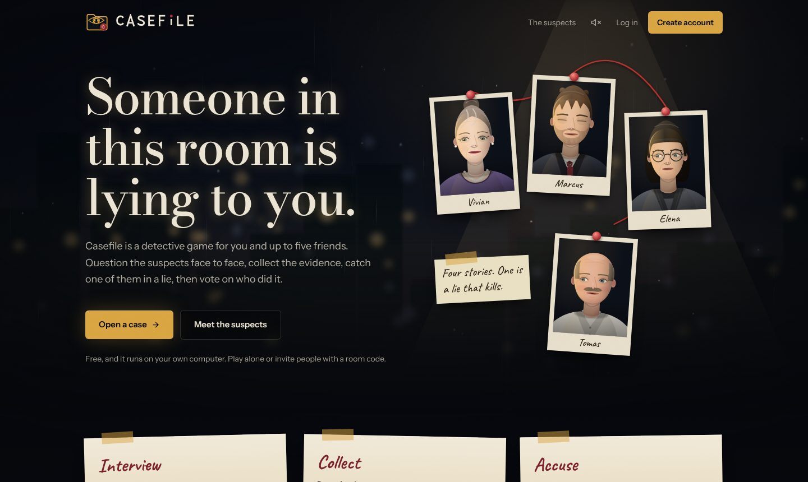
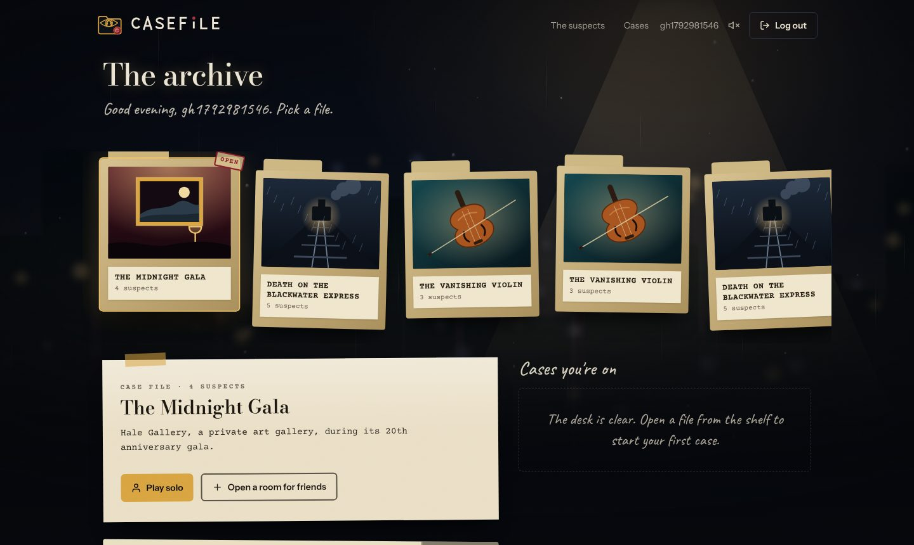
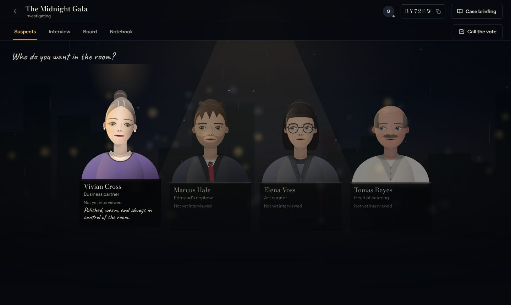
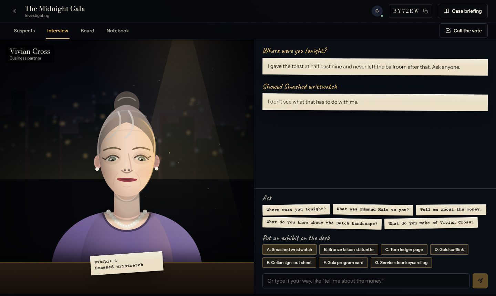
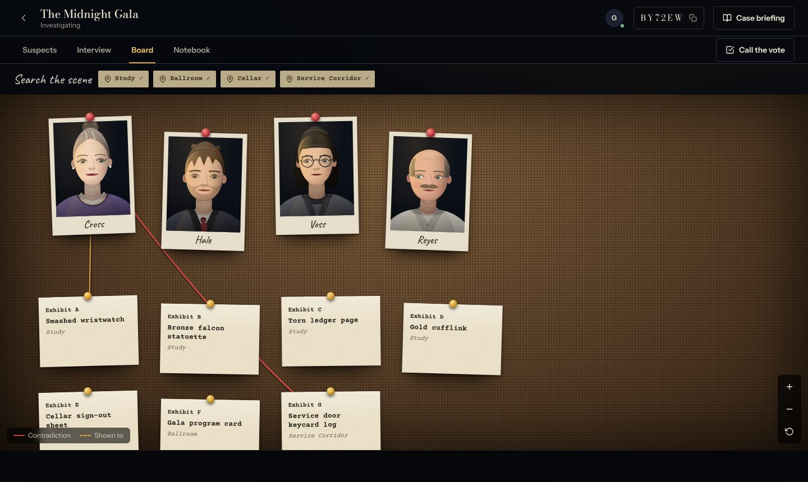

# Casefile AI

A multiplayer detective game where the suspects are AI characters, but a deterministic engine owns every fact. The AI only words what the engine decides, so it can't invent clues or leak the solution. Free to run, no paid APIs.

You and up to five friends interview four suspects, search a gallery for evidence, catch someone in a lie, then vote on who did it.

## Screenshots
| | |
|---|---|
|  |  |
|  |  |



## How it works
- **Engine** (`backend/app/engine`): pure Python. Holds the case, what each suspect knows, what you've found, and what counts as a contradiction. No web, database or AI code in it.
- **AI layer** (`backend/app/ai`): a suspect's answer is a fixed case-file line. If Ollama is on, the model rewords it. Every reply is checked (numbers unchanged, same meaning, no new names, no leaked secrets, no markdown). Anything that fails the check, or any outage, falls back to the original line. The model never sees secrets or the solution.
- **Rooms**: FastAPI + SQLite + WebSockets. Host-only phase changes, members-only access, optimistic locking so two players acting at once never corrupt the room.
- **Frontend**: React, Vite, Tailwind, Framer Motion.

## Run it (Windows, PowerShell)
Backend:
```powershell
cd backend
conda activate casefile
pip install -r requirements.txt
alembic upgrade head
python -m uvicorn app.main:app --port 8000
```
Frontend, in a second window:
```powershell
cd frontend
npm install
npm run dev
```
Open http://127.0.0.1:5173. For a second player, use a private window and join with the room code.

## Optional: a real AI voice with Ollama
```powershell
ollama pull llama3.2:3b
$env:AI_PROVIDER="ollama"
python -m uvicorn app.main:app --port 8000
```
Check `http://127.0.0.1:8000/ai/status`. Without Ollama the game uses the scripted lines and plays the same.

## Settings (environment variables, all optional)
`SECRET_KEY`, `ADMIN_USERNAMES`, `DATABASE_URL`, `TOKEN_MINUTES`, `AI_PROVIDER` (`mock` or `ollama`), `OLLAMA_MODEL`, `OLLAMA_URL`, `OLLAMA_TIMEOUT`, `CORS_ORIGINS`, and `VITE_API_URL` for the frontend.

## Adding cases
Log in as the admin (the first account you create, or the names in `ADMIN_USERNAMES`) and open **Cases** in the header. Open a .json file (two extra cases are in the `cases` folder), paste JSON, or start from a template, check it, and save. It then appears in the lobby's case picker.

## Tests
```powershell
cd backend
python -m pytest -q
```

## Security notes
Passwords use scrypt. Login tokens are signed JWTs. Five wrong passwords for one username from one address lock that login for five minutes, and registration is capped at ten per hour per address. Players' free-text questions are treated as untrusted. Limits are kept in memory, so they reset when the server restarts.

## Limits
One server process only (the live-connection hub is in memory). SQLite by default. One case ships today (*The Midnight Gala*); more can be added from the Cases page. Every case is checked for consistency before it can be used.


## Cinematic frontend (latest)

The frontend is a game, not a dashboard: intro, archive of case folders, suspect lineup, interrogation room, evidence board, voting and a staged reveal.

- **Characters** (`frontend/src/characters/`): 12 hand-specified suspects keyed by stable suspect id, plus a seeded generator for admin-added cases. Layered SVG; blink, breathing, gaze, head tilt and mouth are animated individually. Gallery at `/cast`.
- **Expressions never leak the truth.** They come from each suspect's public personality line and from what the player just did (asking, presenting an exhibit, waiting), never from whether the answer was true.
- **Evidence board:** threads are drawn only for real relationships: contradictions in the journal and exhibits you showed to a suspect. Layout and zoom are saved per room in localStorage.
- **Reveal** uses only the server's `result`. It has a Skip button and is skipped automatically under reduced motion.
- **Sound** is synthesized in the browser, off by default, toggle in the header. The intro plays once per browser session.
- Limitations: portraits are stylized vector art, not painted; the board has no pinch-zoom (use the zoom buttons on touch); AI-worded answers are unchanged.
